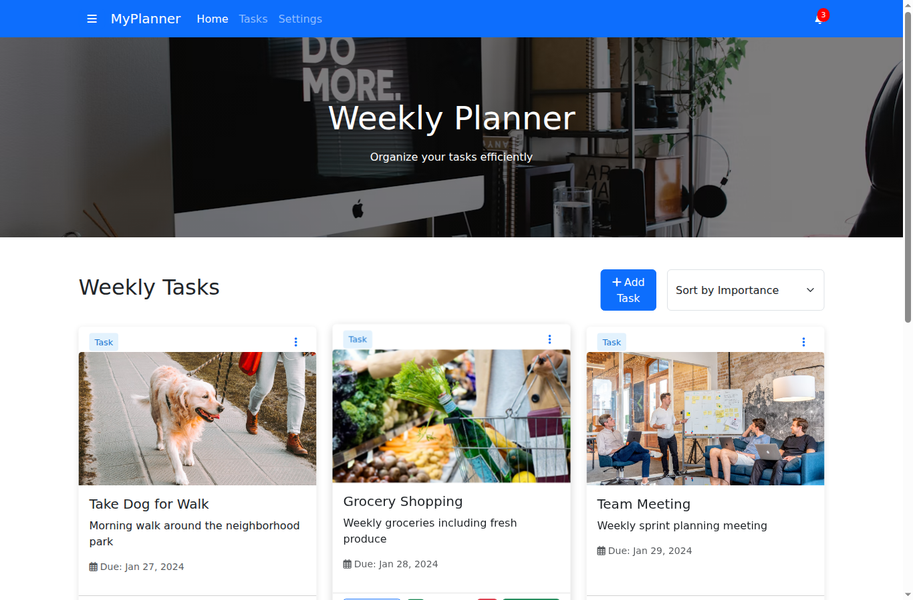
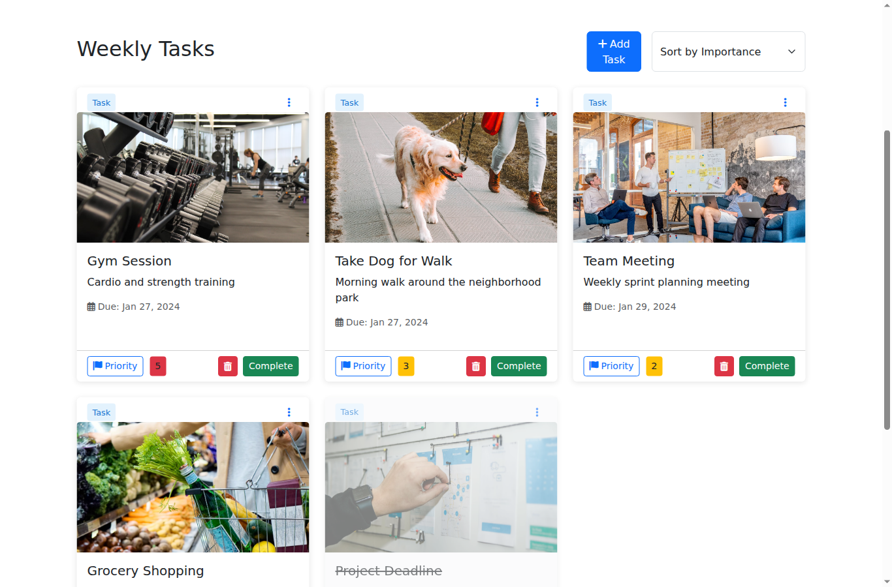
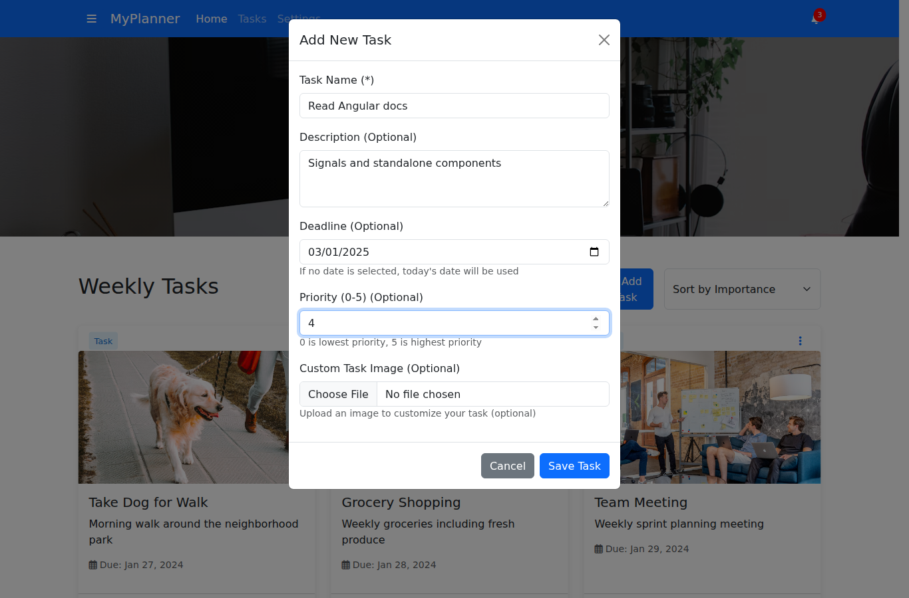
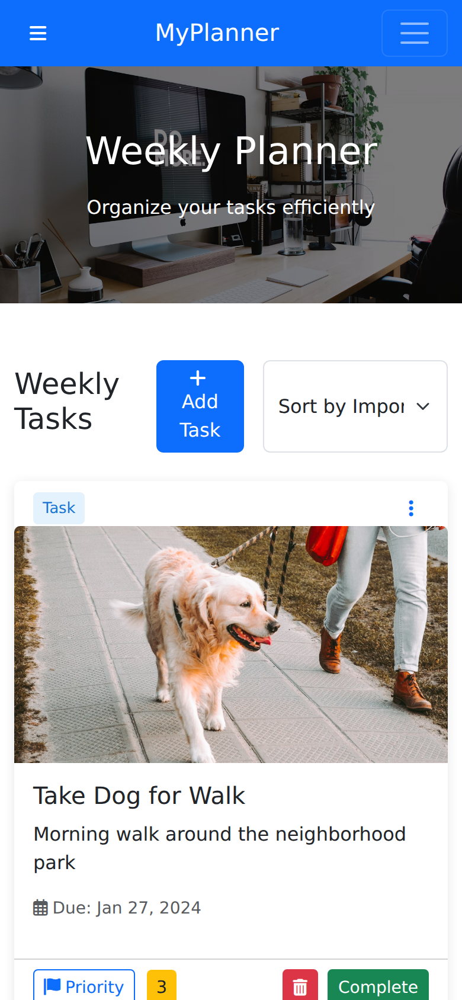

# MyPlanner: Weekly Task Planner

A responsive task management app built with plain HTML, CSS and JavaScript. You can add tasks with a deadline, priority and picture, sort them, mark them as done and delete them, all in the browser with no backend.


> **Live demo:** _coming soon_. To run it yourself, see [Run locally](#run-locally).

| Home | Sorted task board |
|---|---|
|  |  |
| **Add a task** | **Mobile** |
|  |  |

---

## Key features

- **Task cards:** every task is shown as a card with a picture, title, description, due date and a coloured priority badge.
- **Add tasks:** a modal form with a required name and optional description, deadline, priority (0–5) and picture. With no deadline the task is due today; with no picture a default image is used.
- **Upload your own picture:** pick an image file and it shows up on the card straight away (read in the browser with `FileReader`, nothing is uploaded).
- **Priorities at a glance:** badges turn green (0–1), yellow (2–3) or red (4–5). The "Priority" button on a card raises it by one, up to 5.
- **Sorting:** sort the board by importance (highest first), deadline (soonest first) or name (A–Z).
- **Complete and undo:** completed tasks fade out and get a strike-through, and can be switched back with "Undo".
- **Delete:** remove a task with the trash button or from the card's ⋮ menu.
- **Responsive layout:** the grid goes from three columns on desktop to one on mobile, with a collapsible navbar and an offcanvas sidebar menu.

## Tech stack

| Area | Tools |
|---|---|
| **Markup** | HTML5 (semantic layout, form validation attributes) |
| **Styling** | Bootstrap 5.3 (grid, modal, offcanvas, dropdowns), Font Awesome 6, custom CSS (hover transitions, media queries) |
| **Logic** | Vanilla JavaScript (ES6 classes, arrow functions, template literals, DOM API, `FileReader`) |
| **Data** | In-memory array of `Task` objects; no backend or database |
| **Tooling** | Git and GitHub |

## My role & contributions

I built this project by myself:

- Designed the page layout: navbar with notification badge, hero banner, task grid, footer with newsletter field and social links.
- Wrote a `Task` class to model a task and the functions that turn each task into a Bootstrap card through the DOM API.
- Built the "Add Task" modal, including the optional fields, default values and image upload.
- Added sorting, priority changes, complete/undo and delete, with the board re-rendered after every change.
- Made the layout responsive with Bootstrap's grid and my own media queries.

## Challenges & solutions

- **Keeping the UI in sync with the data:** all tasks live in one `items` array. Every action (add, delete, complete, sort) updates the array first and then calls a single `renderItems()` function that rebuilds the board, so the screen always matches the data.
- **Images without a server:** uploaded pictures are turned into data URLs with `FileReader`, so a custom picture appears on the card instantly without any backend storage.
- **Sensible defaults:** only the task name is required. Missing fields fall back to defaults (today's date, priority 0, a standard image), which keeps the form quick to fill in.

## Run locally

No build step or dependencies are needed. Bootstrap and Font Awesome are loaded from a CDN.

```bash
git clone https://github.com/djudiasaad/Task-Management-App.git
cd Task-Management-App

# open index.html directly, or serve the folder:
python3 -m http.server 8080
# then visit http://localhost:8080
```

## Folder structure

```
Task-Management-App/
├── index.html        # page layout and Add Task modal
├── css/styles.css    # custom styles and responsive tweaks
├── js/script.js      # Task class, rendering, sorting and event handlers
├── images/           # pictures for the sample tasks
└── docs/screenshots/ # README screenshots
```

## Future improvements

- Save tasks in `localStorage` so they are still there after a page reload.
- Give every task a truly unique ID (e.g. `crypto.randomUUID()`) and finish the "Edit" and "Share" menu items.
- Keep the selected sort order after adding or completing a task.
- Filter by status (open/completed) and search by name.
- Connect a REST API and database so tasks can be synced between devices.

## License

Released under the [MIT License](LICENSE).
